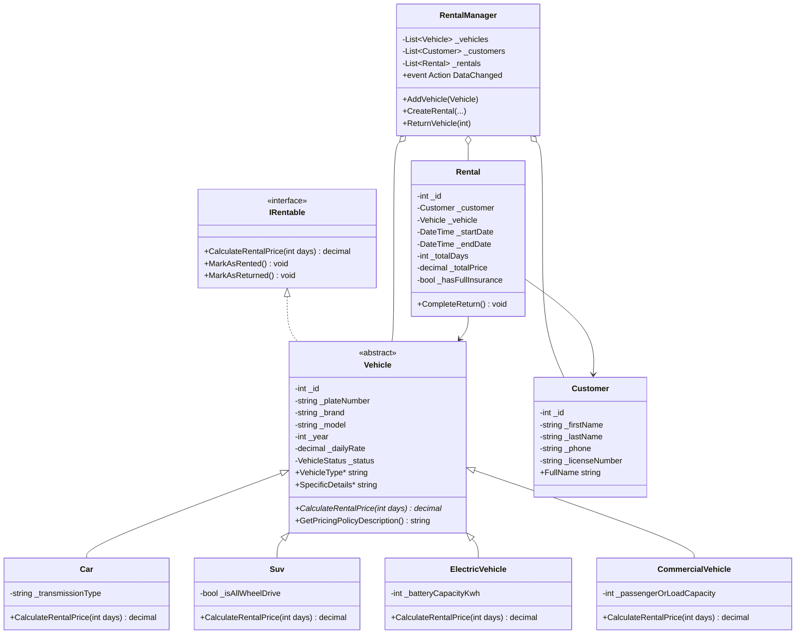

<div align="center">

# 🚗 SYK Fleet — Araç Kiralama Yönetim Sistemi
### *(Vehicle Rental Management System)*

[](https://learn.microsoft.com/en-us/dotnet/csharp/)
[](https://dotnet.microsoft.com/)
[](https://github.com/SeFaYuSuFk/25905007_SefaYusufKutuk_VehicleRentalSystem)
[](https://github.com/SeFaYuSuFk/25905007_SefaYusufKutuk_VehicleRentalSystem)

**BGY203 / YBS223 — Nesne Tabanlı Programlama Dersi Proje Ödevi**  
Modern Windows Forms arayüzüne sahip, katmanlı ve gerçek polimorfizm uygulayan masaüstü filo & araç kiralama yönetim sistemi.

</div>

---

## 👨‍💻 Geliştirici ve Ders Bilgileri

| Bilgi | Açıklama |
| :--- | :--- |
| **Öğrenci Adı Soyadı** | **Sefa Yusuf Kütük** |
| **Okul Numarası** | **25905007** |
| **Bölüm** | Yazılım Geliştirme |
| **Ders Kodu & Adı** | BGY203 / YBS223 • Nesne Tabanlı Programlama |
| **Öğretim Elemanı** | Dr. Öğr. Üyesi Tohid YOUSEFİ |
| **Geliştirme Ortamı** | C# • .NET 10.0 Windows Forms • Visual Studio / Git |
| **GitHub Repository** | [SeFaYuSuFk/25905007_SefaYusufKutuk_VehicleRentalSystem](https://github.com/SeFaYuSuFk/25905007_SefaYusufKutuk_VehicleRentalSystem) *(Private)* |

---

## 🎯 Projenin Amacı ve Öne Çıkan Farklarımız

Bu proje, standart CRUD işlemlerinin ötesine geçerek **Nesne Tabanlı Programlama (OOP)** ilkelerini gerçek bir iş akışı içinde çalışır halde sunmak amacıyla geliştirilmiştir:

- **4 Farklı Araç Sınıfı ile Gerçek Polimorfizm:** Yalnızca tek bir `Car` sınıfı yerine; `Car` (Binek Otomobil), `Suv` (4x4 Arazi), `ElectricVehicle` (Elektrikli) ve `CommercialVehicle` (Ticari/VIP) sınıfları `CalculateRentalPrice(int days)` metodunu kendi tarife kurallarına göre `override` eder.
- **Event-Driven (Olay Tabanlı) Senkronizasyon:** `RentalManager` içindeki `event Action? DataChanged` delegesi sayesinde herhangi bir modülde yapılan ekleme, silme, kiralama veya iade işlemi Dashboard ve tüm listeleri anında günceller.
- **Modern Dark/Flat Dashboard Tasarımı:** Sol yan menü (Sidebar), renkli dinamik istatistik kartları, canlı arama/filtreleme çubukları ve sağ tarafta anlık güncellenen **Kiralama Ücret Özeti** paneli.
- **Özel İş Kuralı Doğrulamaları:** `RentalValidationException` özel istisna sınıfı ile plaka tekrarı, ehliyet no tekrarı, kiradaki aracı silme, aktif kiralamalı müşteriyi silme ve geçersiz tarih seçimi engellenir.
- **Ekstra Tam Kasko Sigortası & Ciro Takibi:** Kiralama sırasında günlük +250 ₺ Tam Kasko opsiyonu eklenebilir ve Dashboard'da toplam filo cirosu canlı izlenebilir.

---

## 🏛️ Sınıf Diyagramı (UML)



---

## 🧩 OOP İlkelerinin Uygulama Kanıtları

| OOP İlkesi | Projede Uygulanışı |
| :--- | :--- |
| **Kapsülleme (Encapsulation)** | Tüm model sınıflarında (`Vehicle`, `Customer`, `Rental`) alanlar `private` tanımlanmış; `set` bloklarında plaka boşluk, ücret `<= 0`, yıl aralığı ve telefon uzunluğu gibi doğrulamalar yapılmıştır. |
| **Soyutlama (Abstraction)** | `IRentable` arayüzü ve `abstract class Vehicle` üzerinden ortak sözleşme belirlenmiş; `CalculateRentalPrice(int days)` ve `VehicleType` soyut (`abstract`) olarak tanımlanmıştır. |
| **Kalıtım (Inheritance)** | `Car`, `Suv`, `ElectricVehicle` ve `CommercialVehicle` sınıfları `Vehicle` temel sınıfından türetilerek ortak özellikleri miras alır, kendi özel alanlarını ekler. |
| **Çok Biçimlilik (Polymorphism)** | `Car` 7+ günde %10 indirim, `Suv` %15/%8 arazi kaskosu, `ElectricVehicle` %5 çevreci indirim ve `CommercialVehicle` günlük 150 ₺ kurumsal sigorta uygulayarak farklı sonuçlar üretir. |

---

## 📸 Uygulama Ekran Görüntüleri ve Test Senaryoları

### 1. Ana Sayfa (Dashboard)
*Toplam araç, müsait, kirada, müşteri, aktif kiralama ve toplam ciro metrikleri koleksiyonlardan anlık hesaplanır.*


### 2. Araç Yönetimi
*4 farklı araç sınıfı (`Otomobil`, `SUV`, `Elektrikli`, `Ticari`) ile araç ekleme, arama, durum filtreleme, güncelleme ve silme.*


### 3. Test Senaryosu — Plaka Tekrarı Engeli
*Sistemde kayıtlı bir plaka (`34 SYK 001`) tekrar eklenmeye çalışıldığında `RentalValidationException` yakalanarak uyarı verilir.*


### 4. Test Senaryosu — Kiradaki Aracı Silme Engeli
*Aktif kirada olan bir araç (`06 ANK 412`) silinmek istendiğinde sistem silme işlemini engeller.*


### 5. Müşteri Yönetimi
*Müşteri ekleme, ehliyet numarası tekillik kontrolü, anlık arama ve güncelleme/silme işlemleri.*


### 6. Araç Kiralama & Canlı Polimorfik Fiyat Hesaplama
*Seçilen aracın türüne göre (`Elektrikli Araç: %5 sıfır emisyon indirimi`) sağ panelde ücret ve Tam Kasko tutarı canlı hesaplanır.*


### 7. Test Senaryosu — Geçersiz Tarih Doğrulaması
*Bitiş tarihi başlangıç tarihinden önce seçildiğinde kullanıcı anında kırmızı doğrulama mesajı ile uyarılır.*


### 8. Test Senaryosu — Kiralama Sözleşmesi Onayı
*Kiralama onaylandığında sözleşme özeti gösterilir ve araç durumu otomatik olarak `Kirada` durumuna geçer.*


### 9. Test Senaryosu — Araç İade İşlemi
*Aktif kiralama seçilip iade alındığında kiralama `Tamamlandı` olur ve araç yeniden `Müsait` statüsüne döner.*


---

## 📁 Proje Klasör Yapısı

```text
25905007_SefaYusufKutuk_VehicleRentalSystem/
├── 01_SourceCode/
│   ├── VehicleRentalSystem.sln
│   └── VehicleRentalSystem/
│       ├── Exceptions/
│       │   └── RentalValidationException.cs
│       ├── Models/
│       │   ├── Enums.cs
│       │   ├── IRentable.cs
│       │   ├── Vehicle.cs
│       │   ├── Car.cs
│       │   ├── Suv.cs
│       │   ├── ElectricVehicle.cs
│       │   ├── CommercialVehicle.cs
│       │   ├── Customer.cs
│       │   └── Rental.cs
│       ├── Services/
│       │   └── RentalManager.cs
│       ├── Forms/
│       │   ├── Theme.cs
│       │   ├── MainForm.cs
│       │   ├── DashboardControl.cs
│       │   ├── VehicleManagementControl.cs
│       │   ├── CustomerManagementControl.cs
│       │   ├── RentalControl.cs
│       │   └── ReturnControl.cs
│       └── Program.cs
├── 02_Application/
│   └── Release/
│       └── VehicleRentalSystem.exe
├── 03_Report/
│   ├── Screenshots/
│   └── Proje_Raporu.pdf
├── 04_GitHub/
│   └── README.md
└── README.md
```

---

## 🚀 Kurulum ve Çalıştırma

### Seçenek 1: Doğrudan Çalıştırma (Hazır Release)
`02_Application/Release/VehicleRentalSystem.exe` dosyasına çift tıklayarak uygulamayı doğrudan başlatabilirsiniz. *(Sistemde .NET 10 Windows Desktop Runtime gerektirir.)*

### Seçenek 2: Kaynak Koddan Derleme
```bash
cd 01_SourceCode
dotnet build VehicleRentalSystem.sln -c Release
dotnet run --project VehicleRentalSystem/VehicleRentalSystem.csproj
```
